# Harbour Shell かんたんガイド

M5Stack Cardputer Zero 上の Harbour Shell の使い方です。アプリや設定の全部の一覧は [HARBOUR-SHELL.md](HARBOUR-SHELL.md)（英語）にあります。英語版のガイドは [GUIDE.md](GUIDE.md) です。

## 1. はじめる

README のインストールのコマンドを実行してから、次のコマンドを使います。

```sh
harbourctl try        # いま Harbour を動かす（次の起動は、これまでの公式ランチャーのまま）
harbourctl official   # 公式ランチャーに戻す
harbourctl enable     # 起動時から Harbour にする（戻すには harbourctl disable）
```

## 2. 覚えておくキー

| キー | はたらき |
|---|---|
| 矢印キー、または **F / X / Z / C** | 上 / 下 / 左 / 右（F・X・Z・C は、Cardputer のキーの矢印の役目です） |
| **Return** | 開く、選ぶ、決める |
| **Esc** | ひとつ戻る。ホームから開いたアプリでは、アプリを閉じる |
| **Tab** | ホームの、アイコンの並びとリスト表示を切り替える |
| **メニューキー** | そのときの画面のメニュー（ショートカットと同じ操作） |

<p>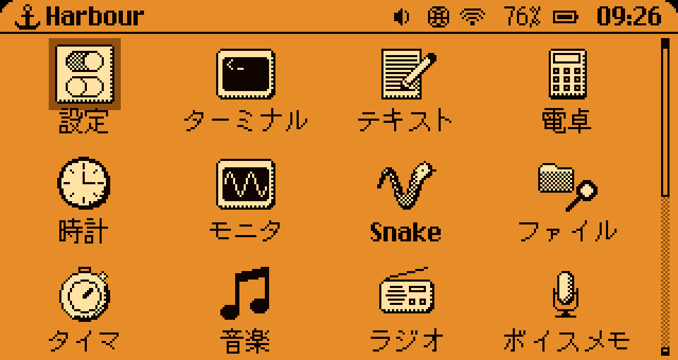 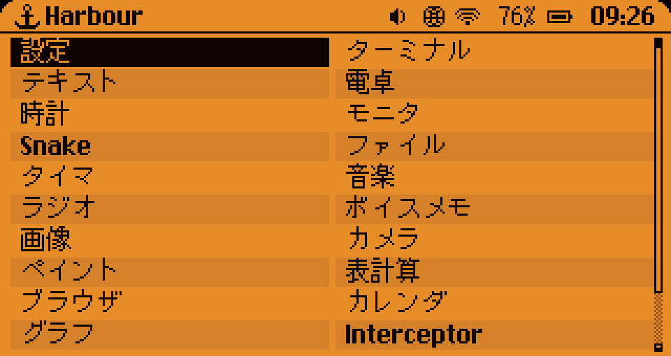</p>

ホームはアプリのアイコンの並びです。**Tab** でリスト表示になります。矢印で動かして、Return で開きます。

<p>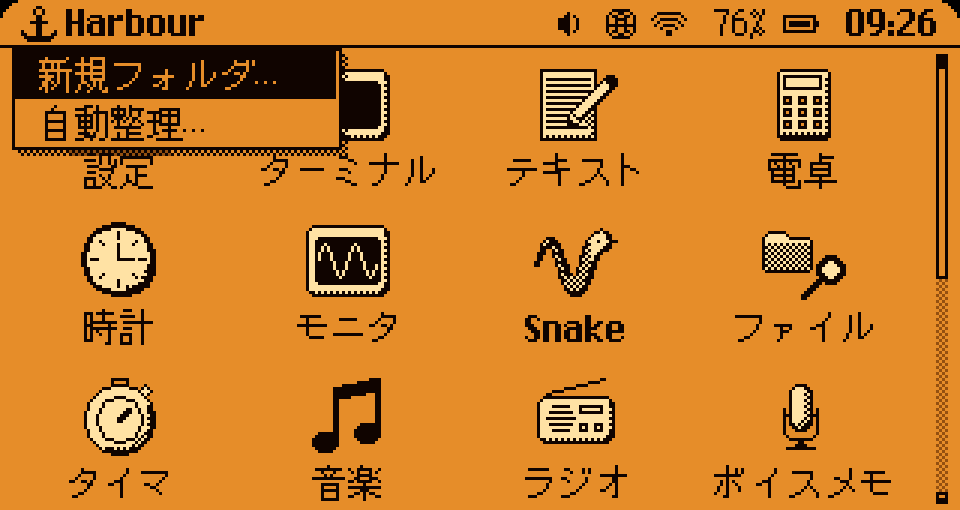</p>

メニューキーで、ホームでも、アプリでも、ダイアログでも、その画面のメニューが開きます。

## 3. 設定

ホームから **設定** を開きます。左のリストが項目です。選んでいる項目には **▶** が付いていて、「右キーで中に入る」という意味です。**Esc** か左キーで、リストに戻ります。

<p>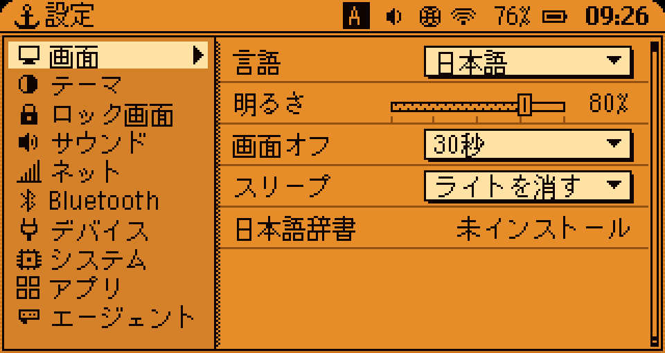 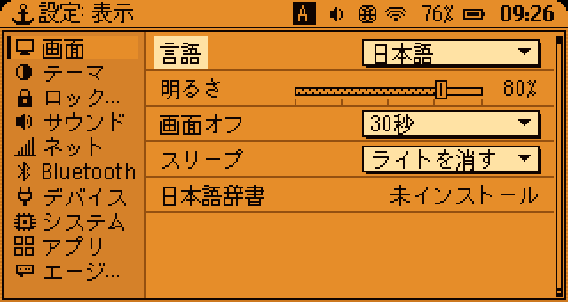</p>

よく使う項目:

- **画面 > 言語**: English と 日本語。
- **画面 > 画面オフ / スリープ**: 放っておくと画面が暗くなります。*ライトを消す* は、バックライトそのものを消します（どれかキーを押すと戻ります）。*黒い画面* は、黒く塗るだけです。
- **ロック**: ロック画面の種類、自動ロック、日付、バッテリー、*アップデート通知*（新しい Harbour Shell が出ているとき）。
- **ネット**: Wi-Fi、機内モード、SSID、IP、DNS、ルーター。
- **デバイス**: Grove と Cap のコネクターの電源。

## 4. 日本語を入力する

**Ctrl + Space** で、日本語入力のオンとオフを切り替えます。上のバーのマークがモードです（**あ** はひらがな、**A** は直接入力）。

<p>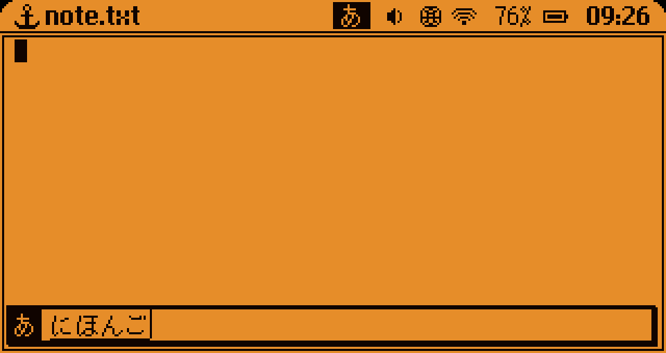</p>

1. ローマ字で打ちます。`nihongo` が にほんご になります（打っている間は、下線が付きます）。
2. **Space** で変換候補が出ます。もう一度 Space で、次の候補に進みます。
3. **Return** か数字キー（**1**〜**5**）で、候補を確定します。**Esc** で、変換をやめます。
4. **Shift + Ctrl + Space** で、あ → ア → ｱ → Ａ と切り替わります。F6〜F10 は、ひらがな、カタカナ、半角カタカナ、全角英数、半角英数にします。

漢字には、辞書が必要です。設定の 画面 にある *日本語辞書* から入れます（頼んだときだけダウンロードします）。辞書がなくても、仮名は打てます。テキストエディタ、ターミナル、Sheet のセル、エージェント、ダイアログなど、文字を打つところなら、どこでも使えます。

## 5. Sheet（表計算）

小さな表計算です。矢印で動いて、**Return**（か **F2**）でセルを編集します。数字や `=` を打ち始めると、そのまま編集になります。セルを選んだまま日本語を確定したときも、編集が始まります。`=A1+A2` のような式や、範囲の関数が使えます。**Ctrl + S** で保存します（CSV）。

<p>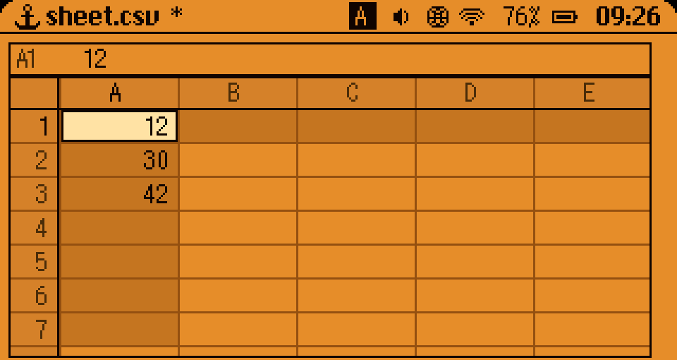</p>

## 6. Interceptor: ネットワーク側

Interceptor は、無線とネットワークの側を見るアプリです。**見るだけ**で、他の人の通信を盗み見ることはしません。タブは、左右キーで切り替えます。

**Wi-Fi** は、まわりのネットワークを、電波の強さ、周波数帯、セキュリティつきで並べます。つながっているものには、印が付きます。

<p>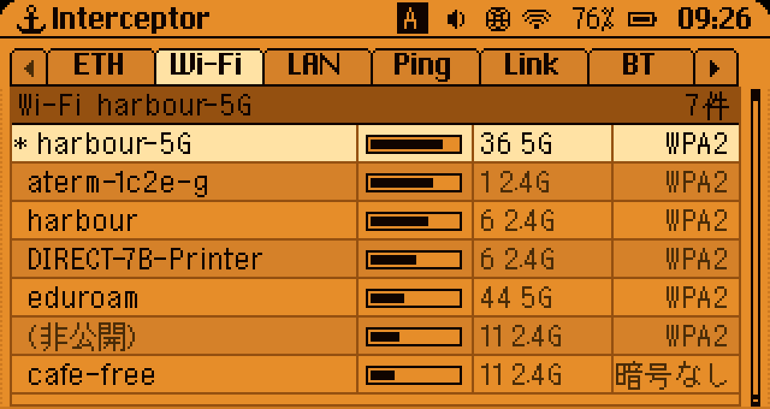</p>

**LAN** は、つながっているネットワークにいる機器を並べます。名前とメーカーは、分かるときに出ます。ルーターと自分には印が付き、初めて見る機器には **NEW** が付きます。最初に、自分のものか管理しているネットワークだけを調べるという確認が出ます（Return で進みます）。

<p>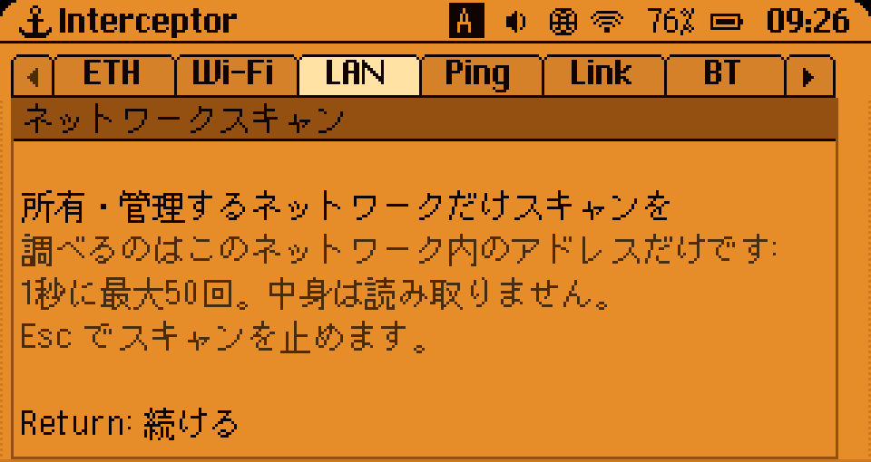 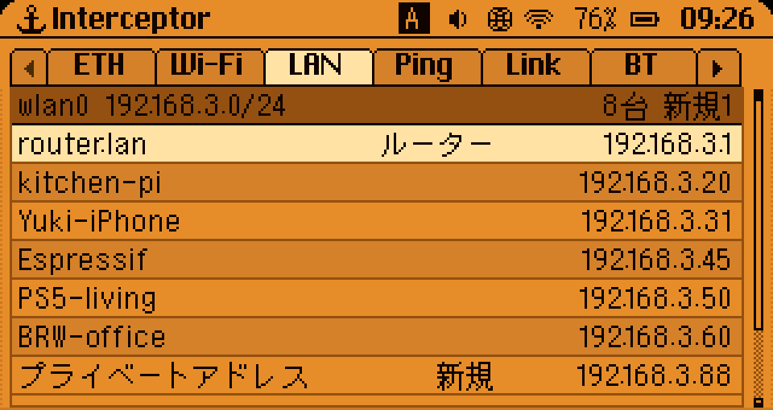</p>

- 機器の上で **Return** を押すと、開いているポートを調べます（よく使うポートの短いリスト、1〜1024、または入力した範囲）。
- **P** で、その機器に ping を送り、Ping タブを開きます。
- **Esc** で、調べている最中のスキャンを止めます。
- 調べるのは、自分のローカルネットワーク（プライベートアドレス）だけで、少しずつ送ります。公開アドレスや、ほかのネットワークは、断ります。

**Ping** は、ルーター、DNS サーバー、選んだアドレスまでの往復の時間を測ります。回数、損失、最小・平均・最大、グラフが出ます。**Return** で始まります。

<p>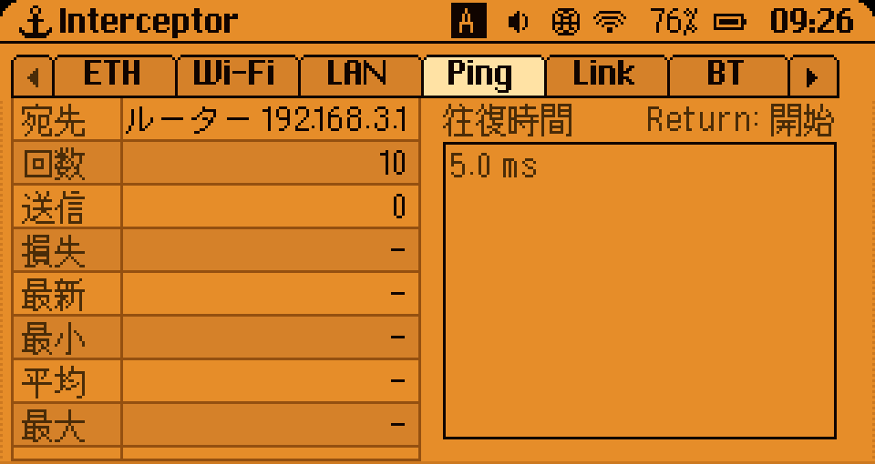</p>

**Link** は、電波と応答時間を、数分間のグラフで記録します。**BT** と **BLE** は、Bluetooth の機器を並べます。

## 7. Devices: 配線の側

**Devices**（ケーブルの束のアイコン）は、Cardputer につないだものを見るアプリです。機器のカテゴリー別のツリーと、USB、Serial、I2C、GPIO、1-Wire、Grove のタブ、CSV に保存できるセンサーログがあります（CSV は Graph で開けます）。

<p>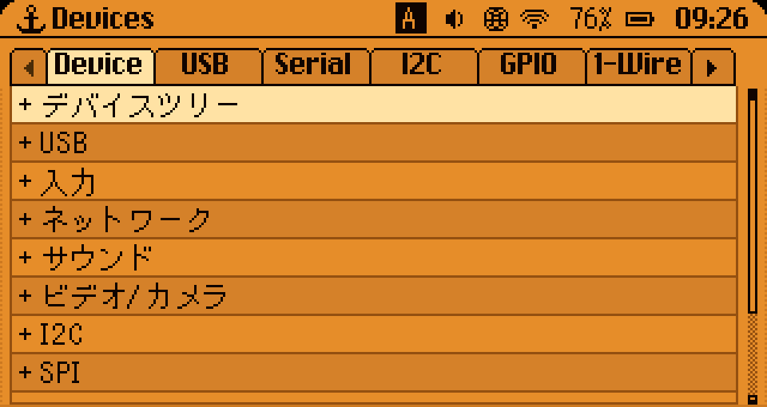</p>

パッケージ（`i2c-tools`、`gpiod`）が要るタブでは、アプリが入れるかどうかを聞きます。apt が root を要するときは、パスワードを聞きます。

## 8. ロック画面

決めた時間がたつと、ロックします。ロック画面には、時計、日付、バッテリーと、新しい版が出ているときは、小さなアップデートのお知らせが出ます。どれかキーを押すと、画面が戻ります。

<p>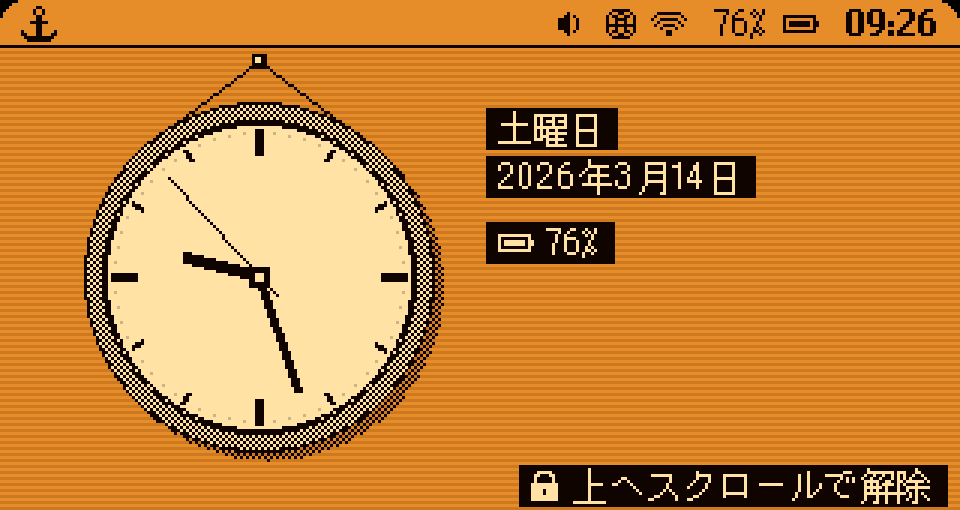</p>

## 9. アップデート

設定の システム で、新しい版を確認できます。手で更新するには、インストールのコマンドをもう一度実行するか、[リリースのページ](https://github.com/kurogedelic/HarbourShell/releases) の `.deb` を入れます。

困ったときは、issue へ: <https://github.com/kurogedelic/HarbourShell/issues>
