# Harbour Shell: a short guide

A tour of Harbour Shell on the M5Stack Cardputer Zero. For the full list of apps and settings see [HARBOUR-SHELL.md](HARBOUR-SHELL.md); the Japanese version of this guide is [GUIDE.ja.md](GUIDE.ja.md).

## 1. Get going

Install it with the one-liner from the README, then:

```sh
harbourctl try        # run Harbour now; the next boot still uses the official launcher
harbourctl official   # back to the official launcher
harbourctl enable     # Harbour at boot (undo: harbourctl disable)
```

## 2. Keys you need

| Key | What it does |
|---|---|
| Arrow keys, or **F / X / Z / C** | Up / Down / Left / Right (F, X, Z, C are the arrows on the Cardputer's key layer) |
| **Return** | Open, choose, confirm |
| **Esc** | Back one step. In an app on the home screen: leave the app |
| **Tab** | Switch the home screen between the icon grid and the list |
| **Menu key** | The app's menu (the same actions as the shortcuts) |

<p>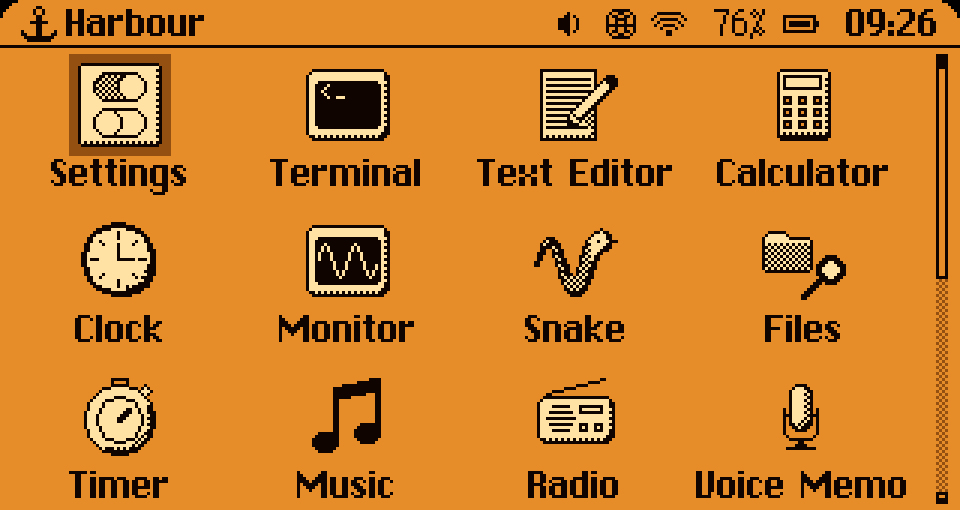 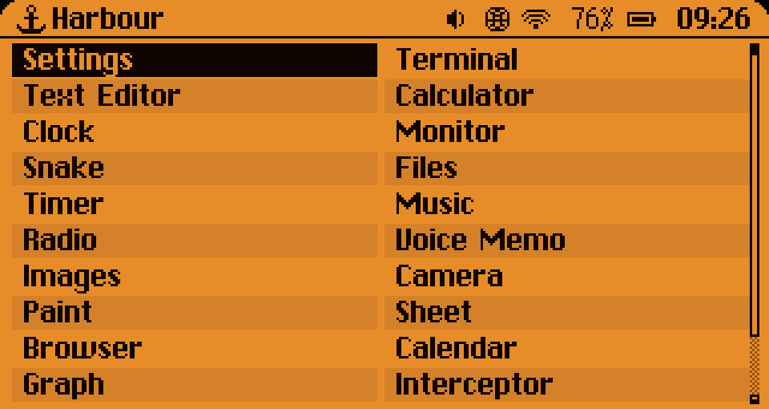</p>

Home is a grid of apps; **Tab** turns it into a list. Move with the arrows, open with Return.

<p>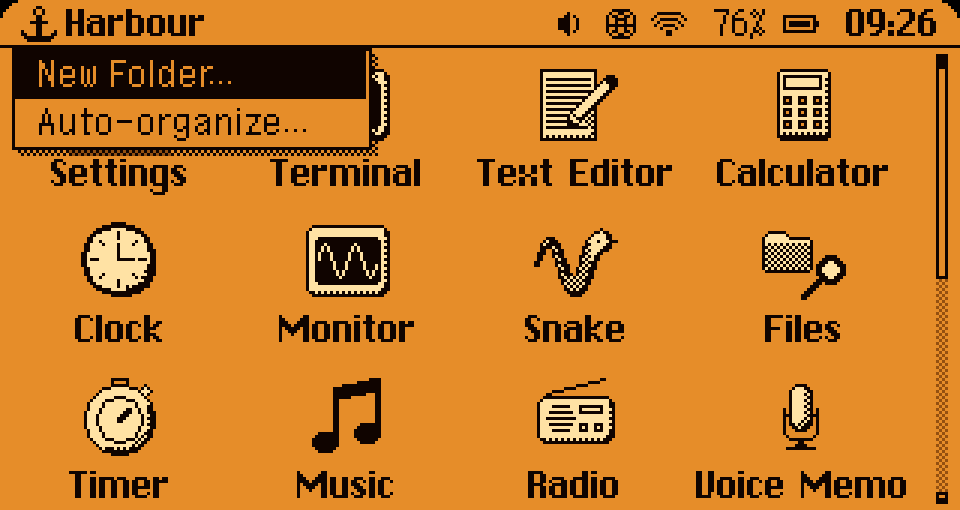</p>

The menu key opens the menu of whatever you are in: Home, an app, a dialog.

## 3. Settings

Open **Settings** from Home. The list on the left is the sections; the section that is selected shows a **▶**, which means *press Right to go in*. **Esc** or Left comes back to the list.

<p>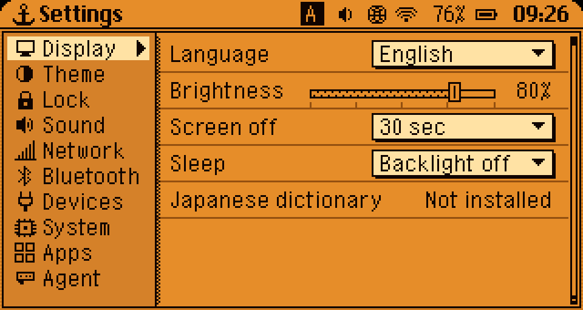 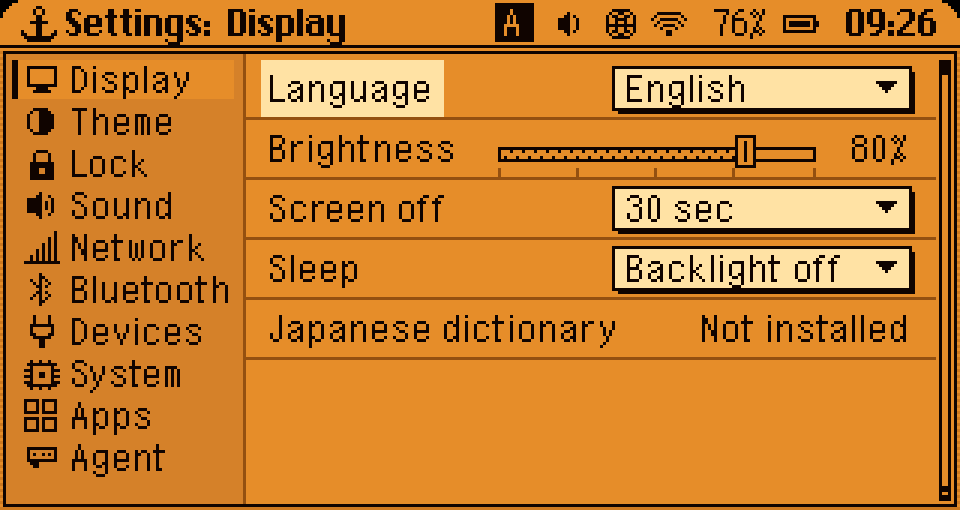</p>

Useful rows:

- **Display > Language**: English or 日本語.
- **Display > Screen off / Sleep**: after the idle time the screen goes dark. *Backlight off* turns the backlight itself off (any key wakes it); *Black screen* only paints black.
- **Lock**: lock screen style, auto lock, date, battery, and the *update notice* (shown when a newer Harbour Shell is out).
- **Network**: Wi-Fi, Airplane mode, SSID, IP, DNS, router.
- **Devices**: power for the Grove and Cap connectors.

## 4. Typing Japanese

Press **Ctrl + Space** to turn the Japanese input on or off. The mark in the top bar shows the mode (**あ** is hiragana, **A** is direct typing).

<p>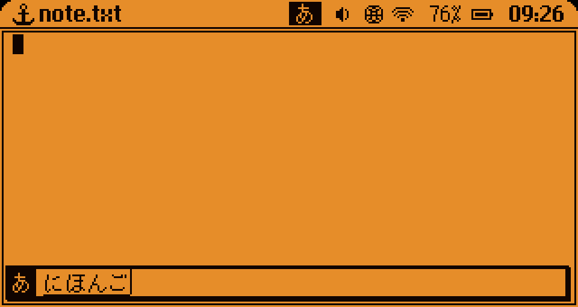</p>

1. Type in romaji: `nihongo` becomes にほんご (underlined while you are still typing).
2. **Space** shows the conversion candidates; Space again goes to the next one.
3. **Return** or a number key (**1**-**5**) commits the candidate. **Esc** cancels the conversion.
4. **Shift + Ctrl + Space** cycles あ → ア → ｱ → Ａ. F6-F10 turn the text into hiragana, katakana, half-width katakana, full-width or half-width letters.

Kanji need the dictionary. In Settings > Display, *Japanese dictionary* installs it (it is downloaded only when you ask). Without it you can still type kana. It works in every text field: Text Editor, Terminal, Sheet cells, the Agent, dialogs.

## 5. Sheet

A small spreadsheet. Move with the arrows; **Return** (or **F2**) edits a cell; start typing a number or `=` to edit at once. Japanese text typed on a selected cell starts the edit too. Formulas such as `=A1+A2` and functions over ranges work. **Ctrl + S** saves (CSV).

<p>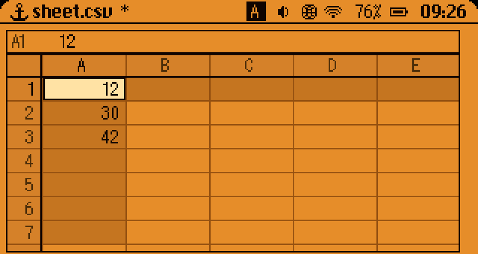</p>

## 6. Interceptor: the network side

Interceptor looks at the wireless and network side. It only **observes**: it does not capture other people's traffic. Switch tabs with Left / Right.

**Wi-Fi** lists the networks around you with signal, channel band and security. The one you are on is marked.

<p>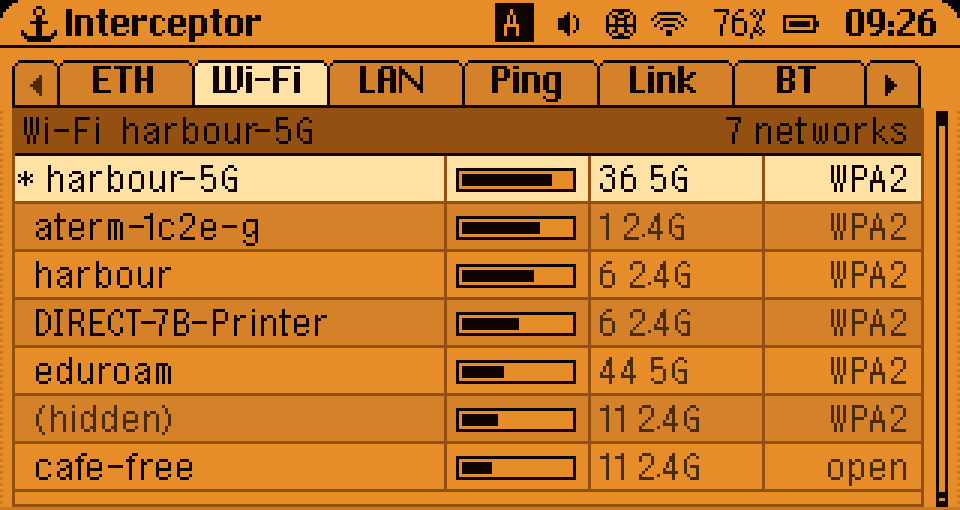</p>

**LAN** lists the devices on the network you are connected to, with names and makers where they can be found, the router and yourself marked, and a **NEW** flag for a device you have not seen before. The first time, it asks you to confirm that you scan only networks you own or manage (press Return).

<p>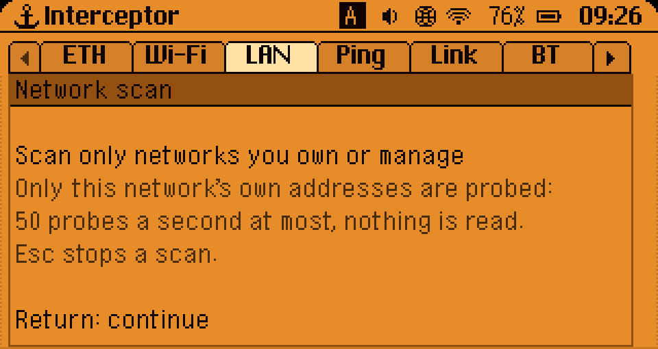 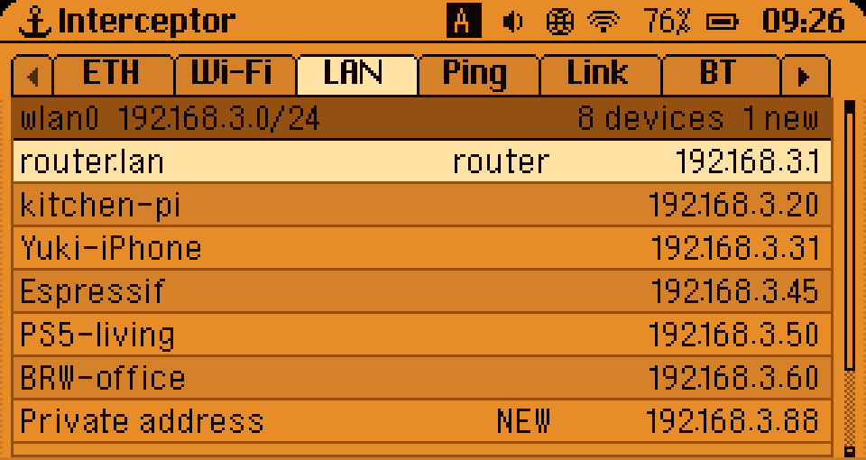</p>

- **Return** on a device checks its open ports (a short list of common ones, 1-1024, or a range you type).
- **P** pings the device and opens the Ping tab for it.
- **Esc** cancels a running scan.
- It only scans your own local network (private addresses), a few probes at a time. Public addresses and other networks are refused.

**Ping** measures the round trip to the router, the DNS server, or an address you pick: count, loss, min / avg / max, and a graph. **Return** starts it.

<p>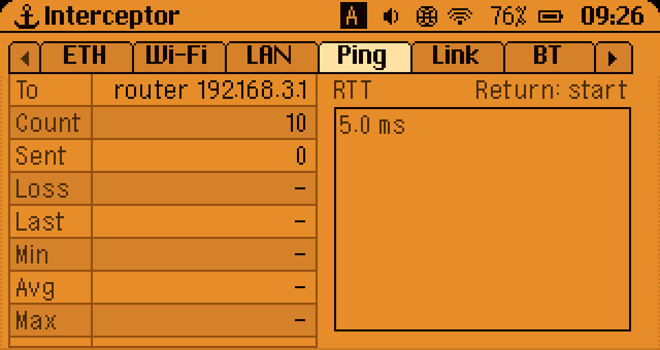</p>

**Link** logs signal and response time over a few minutes; **BT** and **BLE** list Bluetooth devices.

## 7. Devices: the wired side

The **Devices** app (icon: a bundle of cables) shows what is plugged in or wired to the Cardputer: a tree of devices by category, then tabs for USB, Serial, I2C, GPIO, 1-Wire, Grove and a sensor log you can save as a CSV (open it in Graph).

<p>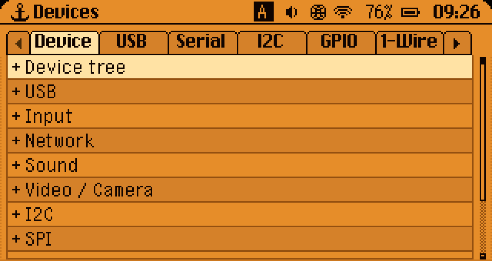</p>

Some tabs need a package (`i2c-tools`, `gpiod`); the app offers to install it and asks for your password when apt needs it.

## 8. Lock screen

The device locks after the time you set. The lock screen shows the clock, the date, the battery and, if there is a newer release, a small update notice. Any key wakes the screen.

<p>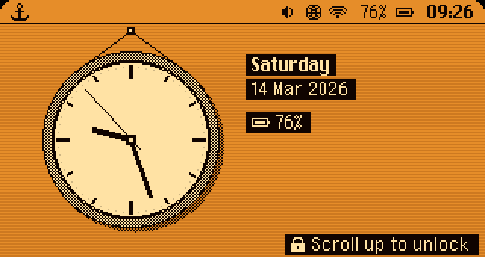</p>

## 9. Updating

Settings > System checks for a new version. To update by hand run the install one-liner again, or install the `.deb` from the [releases page](https://github.com/kurogedelic/HarbourShell/releases).

Found a problem? Open an issue: <https://github.com/kurogedelic/HarbourShell/issues>
